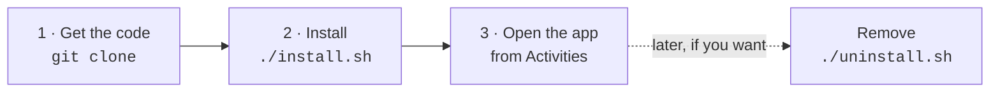

# Letter of Motivation

Write one-page A4 application letters and export them as PDF. Each application has its own folder
(for example `~/Applications/ACME`) with a `letter.toml` holding that letter's text.


There are two ways to use it: a GNOME desktop app and a command-line tool. Both use the same template
(`template/`) and the same rendering code (`lomgen/core.py`).

## Setup in three steps



**1. Get the code**

```sh
git clone https://github.com/yannickbohrer/letter-of-motivation-generator.git
cd letter-of-motivation-generator
```

**2. Install**

```sh
./install.sh
```

That's it. No sudo needed. If a system package is missing, the installer stops and prints the exact
`sudo apt install …` line to run, then you run `./install.sh` again. (On Debian/Ubuntu these are
`python3-gi gir1.2-gtk-4.0 gir1.2-adw-1 python3-venv poppler-utils`.)

**3. Open it**

Open **Letter of Motivation** from Activities, or run `letter-of-motivation [folder]` in a terminal.
On first start, pick the folder that holds your applications, then set your name under Preferences.

| What you want  | Command                         |
| -------------- | ------------------------------- |
| Install        | `./install.sh`                  |
| Update         | `git pull && ./install.sh`      |
| Uninstall      | `./uninstall.sh`                |

`./uninstall.sh` removes the app, its launcher and menu entry. Your letters and your settings in
`~/.config/letter-of-motivation-generator/` stay.

<details>
<summary>Where the installer puts things</summary>

| What                    | Where                                                   |
| ----------------------- | ------------------------------------------------------- |
| App and its Python env  | `~/.local/share/letter-of-motivation-generator/`        |
| Launcher                | `~/.local/bin/letter-of-motivation`                     |
| Menu entry and icon     | `~/.local/share/applications/`, `~/.local/share/icons/` |
| Your details, signature | `~/.config/letter-of-motivation-generator/`             |

</details>

## Desktop app

- **Applications list**: one row per folder in your applications folder. Each row shows whether that
  letter has been exported and how many pages it has.
- **Editor**: the fields are in the same order as on the page. Changes save to `letter.toml` as you
  type, and the comments in the file are kept.
- **Page**: the page updates as you type. The bar on its right edge shows how much of the page the
  letter fills, and turns red if the letter runs onto a second page. Click a part of the page to
  jump to its field.

### Your details

Your name, default place, file-name suffix and signature are set under Preferences. They are stored
in `~/.config/letter-of-motivation-generator/` (`sender.toml`, `signature.svg` or `.png`), and the CLI
uses them too. If that folder doesn't exist, both fall back to `template/`.

## Command line

```sh
python3 create_letter-of-motivation.py <folder>            # PDF without signature
python3 create_letter-of-motivation.py <folder> --signed   # with signature
python3 create_letter-of-motivation.py <folder> --watch    # rebuild on save + browser preview
```

The first run on a folder without `letter.toml` creates one from `template/letter.toml`.
See [`example/letter.toml`](example/letter.toml) for a letter that uses every field.

## Development

Run straight from the repository without installing:

```sh
python3 -m venv --system-site-packages .venv && .venv/bin/pip install -r requirements.txt
.venv/bin/python -m lomgen
```

## License

[MIT](LICENSE) © 2026 Yannick Bohrer

The bundled Roboto fonts in `template/fonts/` are licensed under the Apache License 2.0
(see [`template/fonts/LICENSE-Roboto.txt`](template/fonts/LICENSE-Roboto.txt)).
