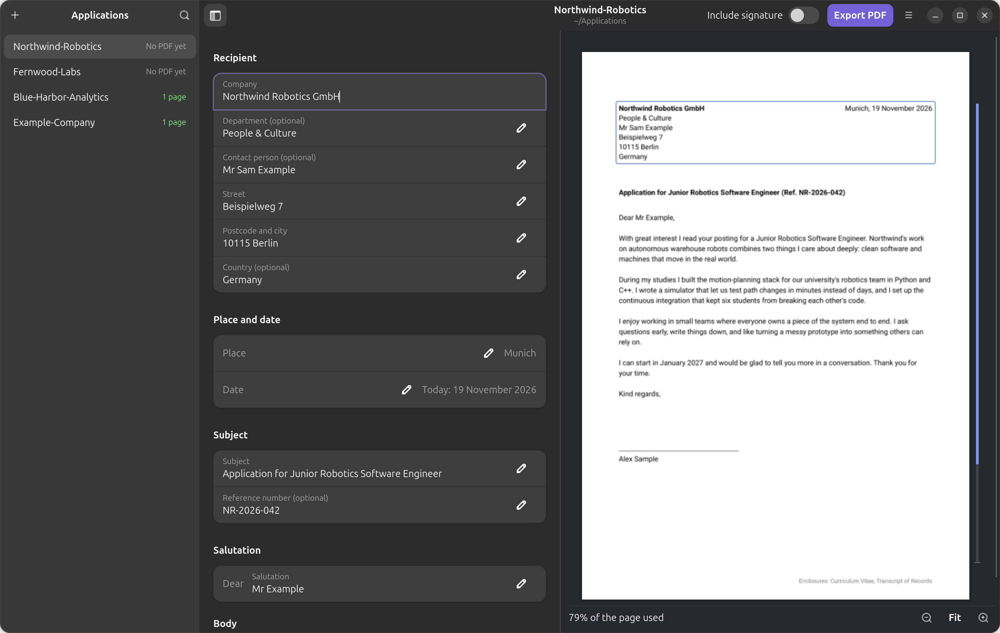

# Letter of Motivation

A small GNOME app for writing one-page A4 application letters and exporting them as PDF.
You type on the left and see the printed page on the right, updating as you go.



- **One folder per application.** Each one (for example `~/Applications/ACME`) holds a plain-text
  `letter.toml` with that letter's text, next to the exported PDF.
- **Live page.** A bar along the page edge shows how full the page is and turns red when the letter
  runs onto a second page. Click any part of the page to jump to its field.
- **Saves as you type.** Comments you add to `letter.toml` by hand are kept.
- **Your details once.** Name, default place and signature are set in Preferences and used in every
  letter. Export with or without the signature.
- **Command line too.** The same letters can be built from a terminal, with a live browser preview.

## Requirements

- Linux with GNOME 49 or newer (libadwaita 1.8+), e.g. Ubuntu 25.10+ or Fedora 43+
- Python 3.11 or newer
- `git`

## Install

```sh
git clone https://github.com/yannickbohrer/letter-of-motivation-editor.git
cd letter-of-motivation-editor
./install.sh
```

No sudo needed: everything goes into your home folder. If a system package is missing, the installer
stops and prints the exact command to install it. Run that, then run `./install.sh` again.

<details>
<summary>The system packages, if you want to install them up front</summary>

| Distribution  | Command |
| ------------- | ------- |
| Debian/Ubuntu | `sudo apt install python3-gi gir1.2-gtk-4.0 gir1.2-adw-1 python3-venv poppler-utils` |
| Fedora        | `sudo dnf install python3-gobject gtk4 libadwaita poppler-utils` |

</details>

## First start

1. Open **Letter of Motivation** from Activities (or run `letter-of-motivation` in a terminal).
2. Pick the folder that will hold your applications, e.g. `~/Applications`.
3. Open **Preferences** (Ctrl+,) and enter your name, default place and the file-name suffix.
   Add your signature as an SVG or a PNG with a transparent background if you want signed PDFs.
4. Click **+** (Ctrl+N), type the company name, and start writing.
5. Press **Export PDF** (Ctrl+E). The PDF lands in the application's folder as
   `letter-of-motivation_<Company>_<your suffix>.pdf`.

## Writing tips

- In the body, a blank line starts a new paragraph. Put `*asterisks*` around words for italics.
- Empty **Place** and **Date** fields use your default place and today's date.
- Running out of room? Lower the **Font size** (9 to 13 pt) under Layout, or trim the text until
  the page bar is no longer red.
- **Include signature** in the header bar adds your signature image. Without it, the PDF name ends
  in `_without-signature`, ready to sign by hand.
- You can also edit `letter.toml` in any text editor; the app reloads it when you save.
  [`example/letter.toml`](example/letter.toml) shows every field.

| Shortcut | Action |
| -------- | ------ |
| Ctrl+N   | New application |
| Ctrl+F   | Search applications |
| Ctrl+E   | Export PDF |
| Ctrl+O   | Choose applications folder |
| Ctrl+,   | Preferences |
| Ctrl+?   | All shortcuts |

## Update and uninstall

| What you want | Command |
| ------------- | ------- |
| Update        | `git pull && ./install.sh` |
| Uninstall     | `./uninstall.sh` |

Uninstalling removes the app, its launcher and menu entry. Your letters and your details in
`~/.config/letter-of-motivation-editor/` stay.

<details>
<summary>Where the installer puts things</summary>

| What                    | Where                                                   |
| ----------------------- | ------------------------------------------------------- |
| App and its Python env  | `~/.local/share/letter-of-motivation-editor/`           |
| Launcher                | `~/.local/bin/letter-of-motivation`                     |
| Menu entry and icon     | `~/.local/share/applications/`, `~/.local/share/icons/` |
| Your details, signature | `~/.config/letter-of-motivation-editor/`                |

</details>

## Command line

Run from the repository folder. It needs the Python environment from [Development](#development)
(one command, once).

```sh
python3 create_letter-of-motivation.py ~/Applications/ACME            # PDF without signature
python3 create_letter-of-motivation.py ~/Applications/ACME --signed   # with signature
python3 create_letter-of-motivation.py ~/Applications/ACME --watch    # rebuild on save, preview at http://127.0.0.1:8765
```

On a folder without `letter.toml`, the first run creates one for you to fill in. The CLI uses the
same details and signature as the app.

## Development

Run straight from the repository without installing:

```sh
python3 -m venv --system-site-packages .venv && .venv/bin/pip install -r requirements.txt
.venv/bin/python -m lomgen
```

The letter's look is in `template/` (`letter.html.j2`, `style.css`); the rendering code shared by the
app and the CLI is `lomgen/core.py`. Developer docs are in [`CLAUDE.md`](CLAUDE.md) and [`docs/`](docs/).

## License

[MIT](LICENSE) © 2026 Yannick Bohrer

The bundled Roboto fonts in `template/fonts/` are licensed under the Apache License 2.0
(see [`template/fonts/LICENSE-Roboto.txt`](template/fonts/LICENSE-Roboto.txt)).
